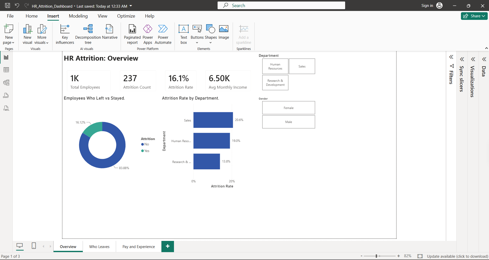
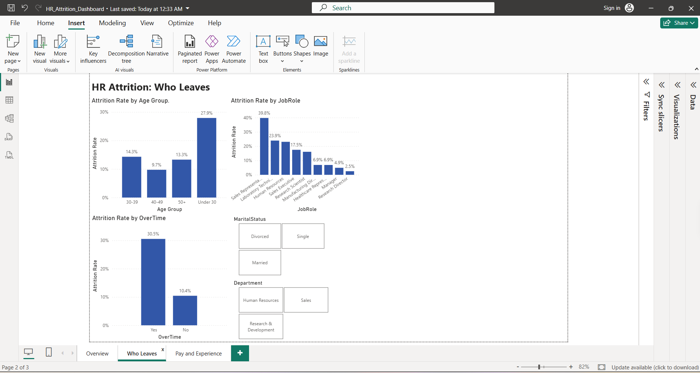
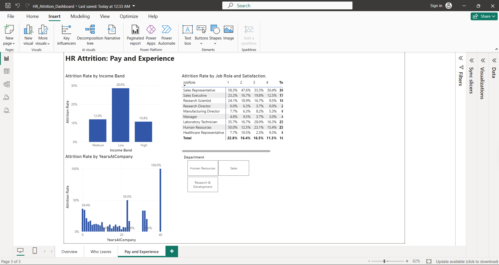

# HR Attrition Dashboard

A Power BI dashboard that shows which employees leave a company and which factors are linked to it.

## Problem
The company loses employees every year. Which groups leave the most, and what can HR do about it?

## Tools
- Excel (data cleaning, helper columns, Cleaning Log)
- Power BI (data model, DAX measures, 3-page dashboard)

## Dataset
IBM HR Analytics Employee Attrition: 1,470 employees, 35 columns.

## Steps
1. **Excel:** Checked blanks (0 found) and duplicates (0 found). Removed 3 columns with the same value in every row (EmployeeCount, Over18, StandardHours). Added Age Group, Attrition Flag and Income Band columns. All steps are in the Cleaning Log sheet.
2. **Power BI:** Loaded the data and wrote 5 DAX measures: Total Employees, Attrition Count, Attrition Rate, Avg Monthly Income, Avg Years at Company.
3. **Dashboard:** Built 3 pages (Overview, Who Leaves, Pay and Experience) with synced slicers.

## Key Numbers
- Total employees: 1,470
- Employees who left: 237
- Attrition rate: 16.1%

## Insights
1. The overall attrition rate is 16.1% (237 of 1,470 employees left).
2. Employees working overtime leave at 30.5%, three times the 10.4% of those who do not.
3. Sales has the highest attrition among departments (20.6%). Sales Representatives leave most of all roles (39.8%).
4. Low-income employees (under 3,000 a month) leave at 28.6%, against about 11% for the high-income band.
5. Employees under 30 leave at 27.9%, the highest age group.
6. Employees in their first 2 years leave most: 36.4% in year 0 and 34.5% in year 1.

## Recommendations
- Cap overtime hours and add support for teams that work extra.
- Review targets, pay and training for the Sales Representative role.
- Review pay for entry-level roles.
- Offer mentoring to young employees and improve onboarding in the first year.

## Dashboard Screenshots
### Overview

### Who Leaves

### Pay and Experience

## Files
- `HR_Attrition_Working.xlsx`: cleaned data, Cleaning Log and Findings
- `HR_Attrition_Dashboard.pbix`: Power BI report (open with Power BI Desktop)

## Author
S Kaviya, final-year CSE student
